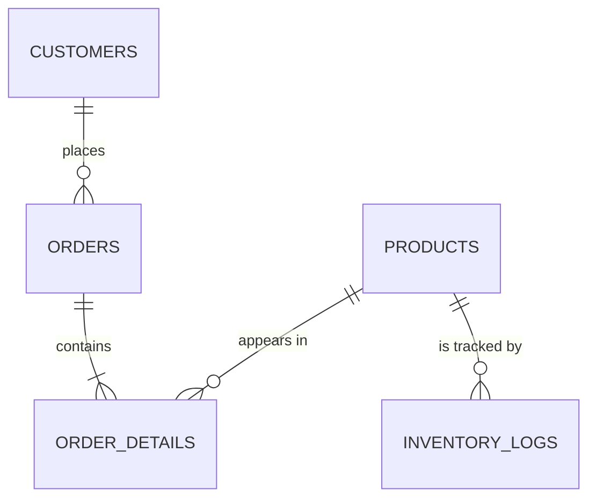

# Inventory and Order Management System (MySQL)

A database-driven system that manages products, customers, orders and inventory for an e-commerce company. Stock is updated automatically when orders are placed, every stock movement is recorded for auditing, low-stock products are detected and replenished, and customers are placed into spending tiers automatically.

> **Author:**OLIVIER KWIZERA· **Course:** SQL FOR DATA PROFESSIONAL ·  · **Date:**23 October 2026

📄 **Full lab report:** [REPORT.md](REPORT.md) · 🗺️ **ER diagram:** [docs/ERD.md](docs/ERD.md) · 📋 **Test output:** [docs/sample_output.txt](docs/sample_output.txt)

---

## Features

| Area | What the system does |
|---|---|
| **Data integrity** | Primary and foreign keys, `CHECK` constraints (no negative prices or stock), unique emails, price stored at time of sale |
| **Order placement** | One procedure call places an order with any number of products, wrapped in a transaction (all-or-nothing) |
| **Automatic stock updates** | Triggers validate stock, deduct it and calculate line and order totals |
| **Inventory audit trail** | Every stock change (sale, restock, opening stock) is logged with before/after values and the order it came from |
| **Bulk discounts** | 5% for 10+ units, 10% for 20+, 15% for 50+, applied automatically |
| **Customer tiers** | Bronze / Silver / Gold, recalculated automatically whenever a customer's spending changes |
| **Replenishment** | Low-stock products are detected and restocked to twice their reorder level in one call, optionally on a daily schedule |
| **Reporting** | Views and queries for order summaries, low stock, customer spending, discounts and best sellers |
| **Performance** | Targeted composite indexes, an indexed generated column for low-stock lookups, and `EXPLAIN` evidence that the indexes are used |

## Entity Relationship Diagram



Full diagram with every column: [docs/ERD.md](docs/ERD.md)

## Repository structure

```
.
├── README.md                    This file
├── REPORT.md                    Full lab report (design, implementation, testing)
├── sql/
│   ├── 00_full_build.sql        Everything in one file (same as running 01-09)
│   ├── 01_schema.sql            Tables, relationships, constraints, indexes
│   ├── 02_functions.sql         fn_bulk_discount, fn_get_tier
│   ├── 03_procedures.sql        sp_place_order, sp_restock_product,
│   │                            sp_replenish_low_stock, sp_update_customer_tier
│   ├── 04_triggers.sql          Stock, logging, totals and tier automation
│   ├── 05_views.sql             vw_order_summary, vw_low_stock,
│   │                            vw_customer_spending, vw_inventory_history
│   ├── 06_sample_data.sql       10 products, 6 customers, opening stock
│   ├── 07_demo_orders.sql       Order placement and stock update demo
│   ├── 08_demo_replenishment.sql Low-stock detection and replenishment demo
│   ├── 09_reports.sql           Report summaries and EXPLAIN
│   └── 10_error_tests.sql       Statements that should fail (validation tests)
├── docs/
│   ├── ERD.md                   Entity relationship diagram
│   └── sample_output.txt        Real output from a clean test run
└── screenshots/                 MySQL Workbench screenshots
```

## Requirements

- **MySQL 8.0.16 or newer.** `CHECK` constraints, `JSON_TABLE` and CTEs require MySQL 8.
- MySQL Workbench, or the `mysql` command-line client

## How to run

> ⚠️ `01_schema.sql` and `00_full_build.sql` **drop and re-create** the `inventory_db` database.

### Option A: one file (quickest)

In MySQL Workbench: **File → Open SQL Script → `sql/00_full_build.sql`**, then click ⚡ (Execute).

### Option B: step by step

Run the files in `sql/` in numerical order, `01` to `09`. Then open `10_error_tests.sql` and run its statements **one at a time**; each one is expected to fail.

### Command line

```bash
mysql -u root -p < sql/00_full_build.sql
```

## Usage examples

```sql
USE inventory_db;

-- Place an order with several products
CALL sp_place_order(1, '[{"product_id":1,"quantity":2},{"product_id":6,"quantity":12}]', @order_id);
SELECT @order_id;

-- Record a supplier delivery
CALL sp_restock_product(10, 30, 'Supplier delivery #1001');

-- Restock every low-stock product to 2x its reorder level
CALL sp_replenish_low_stock(2);

-- Reports
SELECT * FROM vw_order_summary;
SELECT * FROM vw_low_stock;
SELECT * FROM vw_customer_spending ORDER BY total_spent DESC;
SELECT * FROM vw_inventory_history WHERE product_name = 'Office Chair';
```

## Lab deliverables

| Deliverable | Where to find it |
|---|---|
| Database schema | [`sql/01_schema.sql`](sql/01_schema.sql), [docs/ERD.md](docs/ERD.md) |
| SQL queries: order placement and stock updates | [`03_procedures.sql`](sql/03_procedures.sql), [`04_triggers.sql`](sql/04_triggers.sql), [`07_demo_orders.sql`](sql/07_demo_orders.sql) |
| SQL queries: inventory tracking | Trigger `trg_order_details_after_insert`, view `vw_inventory_history`, [`08_demo_replenishment.sql`](sql/08_demo_replenishment.sql) |
| SQL queries: customer categorization | `fn_get_tier`, `trg_orders_after_update`, [`09_reports.sql`](sql/09_reports.sql) |
| Views | [`sql/05_views.sql`](sql/05_views.sql) |
| Replenishment system | `sp_restock_product`, `sp_replenish_low_stock`, [`08_demo_replenishment.sql`](sql/08_demo_replenishment.sql) |
| Report summaries | [`sql/09_reports.sql`](sql/09_reports.sql), [docs/sample_output.txt](docs/sample_output.txt) |

## Results at a glance

From a clean build using the included sample data:

- **9 orders**, total revenue **6,536.42**, with bulk-discount savings of **228.50** for customers
- Tiers assigned automatically: **2 Gold, 1 Silver, 3 Bronze**
- **4 low-stock products** detected and replenished, followed by **2 more** after new orders: the full sell → low → restock cycle
- All **7 validation tests** rejected bad input with clear messages, and failed orders saved nothing

See [REPORT.md](REPORT.md) for the complete test table and explanations.
