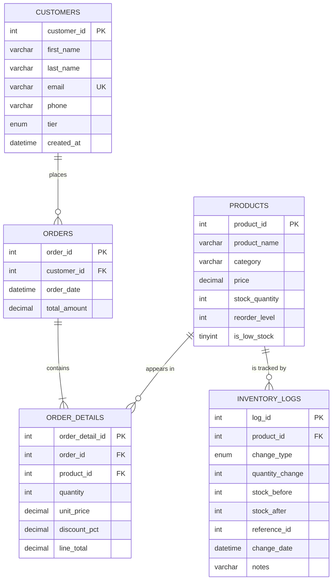
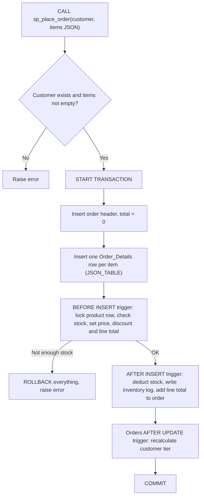

# Lab Report: Inventory and Order Management System

| | |
|---|---|
| **Names** | Olivier Kwizera|
| **Course** |MYSQL FOR DATA PROFESSIONAL |
| **Instutition** |AmaliTech |
| **Date** |23 October 2026 |
| **Technology** | MySQL 8.0, MySQL Workbench |

---

## Table of Contents

1. [Introduction](#1-introduction)
2. [Objectives and Scope](#2-objectives-and-scope)
3. [Phase 1: Database Design and Schema](#3-phase-1-database-design-and-schema)
4. [Phase 2: Order Placement and Inventory Management](#4-phase-2-order-placement-and-inventory-management)
5. [Phase 3: Monitoring and Reporting](#5-phase-3-monitoring-and-reporting)
6. [Phase 4: Stock Replenishment and Automation](#6-phase-4-stock-replenishment-and-automation)
7. [Phase 5: Views and Optimization](#7-phase-5-views-and-optimization)
8. [Testing and Results](#8-testing-and-results)
9. [Deliverables Checklist](#9-deliverables-checklist)
10. [Limitations and Future Improvements](#10-limitations-and-future-improvements)
11. [Conclusion](#11-conclusion)
12. [Appendix: How to Run and Screenshots](#12-appendix-how-to-run-and-screenshots)

---

## 1. Introduction

An e-commerce company needs reliable control over its products, customers and orders. The core business problem is keeping **stock levels accurate**: every sale must reduce stock, every delivery must increase it, and the company must know when a product is running low before it runs out. Management also wants insight into customer behaviour, such as who spends the most, and wants to reward large orders with discounts.

This project implements a relational database in MySQL 8 that solves these problems. The central design principle is that **business rules live inside the database**, enforced by constraints, transactions, triggers and stored procedures. This makes stock, totals, discounts, tiers and the audit trail correct no matter which application or person inserts the data.

## 2. Objectives and Scope

| Phase | Objective | Implemented by |
|---|---|---|
| 1 | Design a schema for products, customers, orders, order details and inventory logs, with enforced integrity | 5 tables, primary/foreign keys, `CHECK` and `UNIQUE` constraints |
| 2 | Process multi-product orders, deduct stock, calculate totals, log every stock change | `sp_place_order` and two `Order_Details` triggers |
| 3 | Order summaries, low-stock reports, spending tiers, bulk discounts | Reporting queries, `fn_bulk_discount`, `fn_get_tier` |
| 4 | Replenish low stock with logging; automate stock, totals and tiers | `sp_restock_product`, `sp_replenish_low_stock`, tier triggers, optional scheduled event |
| 5 | Views for orders and low stock; performance optimization | 4 views, 6 additional indexes, generated column, `EXPLAIN` analysis |

---

## 3. Phase 1: Database Design and Schema

### 3.1 Entity Relationship Diagram



Orders and Products have a many-to-many relationship (one order holds many products, and one product appears in many orders). It is resolved through the **Order_Details** junction table.

### 3.2 Data Dictionary

**Products**

| Column | Type | Constraints / notes |
|---|---|---|
| product_id | INT | PK, auto-increment |
| product_name | VARCHAR(100) | NOT NULL |
| category | VARCHAR(50) | NOT NULL, indexed |
| price | DECIMAL(10,2) | NOT NULL, `CHECK (price >= 0)` |
| stock_quantity | INT | NOT NULL, default 0, `CHECK (stock_quantity >= 0)` |
| reorder_level | INT | NOT NULL, default 10, `CHECK (reorder_level >= 0)` |
| is_low_stock | TINYINT | Generated: `stock_quantity < reorder_level`, stored and indexed |

**Customers**

| Column | Type | Constraints / notes |
|---|---|---|
| customer_id | INT | PK, auto-increment |
| first_name, last_name | VARCHAR(50) | NOT NULL |
| email | VARCHAR(100) | NOT NULL, UNIQUE |
| phone | VARCHAR(20) | Optional |
| tier | ENUM('Bronze','Silver','Gold') | Default 'Bronze', maintained by trigger |
| created_at | DATETIME | Default current timestamp |

**Orders**

| Column | Type | Constraints / notes |
|---|---|---|
| order_id | INT | PK, auto-increment |
| customer_id | INT | FK → Customers, `ON DELETE RESTRICT` |
| order_date | DATETIME | Default current timestamp |
| total_amount | DECIMAL(12,2) | `CHECK (>= 0)`, calculated by trigger |

**Order_Details**

| Column | Type | Constraints / notes |
|---|---|---|
| order_detail_id | INT | PK, auto-increment |
| order_id | INT | FK → Orders, `ON DELETE CASCADE` |
| product_id | INT | FK → Products, `ON DELETE RESTRICT` |
| quantity | INT | `CHECK (quantity > 0)` |
| unit_price | DECIMAL(10,2) | Price at the time of sale, set by trigger |
| discount_pct | DECIMAL(5,2) | `CHECK (0–100)`, set by trigger |
| line_total | DECIMAL(12,2) | Set by trigger |
| _(constraint)_ | | `UNIQUE (order_id, product_id)` |

**Inventory_Logs**

| Column | Type | Constraints / notes |
|---|---|---|
| log_id | INT | PK, auto-increment |
| product_id | INT | FK → Products, `ON DELETE RESTRICT` |
| change_type | ENUM('ORDER','RESTOCK','ADJUSTMENT') | Why the stock changed |
| quantity_change | INT | Signed: negative = stock out, positive = stock in |
| stock_before, stock_after | INT | Snapshot of stock around the change |
| reference_id | INT | The order that caused the change (for `ORDER` rows) |
| change_date | DATETIME | Default current timestamp |
| notes | VARCHAR(255) | Human-readable description |

### 3.3 Key Design Decisions

1. **Price is stored at the time of sale.** `Order_Details.unit_price` is copied from Products when the order is placed. If prices change later, historical orders and revenue reports remain accurate.
2. **Referential actions are chosen per relationship.** `RESTRICT` protects history: customers with orders, and products that have been sold or logged, cannot be deleted. `CASCADE` is used only where child rows have no meaning without their parent (order lines without their order).
3. **Integrity is enforced at the database level.** `CHECK` constraints reject negative prices, negative stock and zero quantities. Because stock can never go below zero, overselling is impossible even if application code has a bug.
4. **Logs use signed quantities with before/after snapshots.** This makes the audit trail self-verifying (`stock_before + quantity_change = stock_after`). The sum of `quantity_change` for a product always equals its current stock.
5. **Opening stock is logged as an `ADJUSTMENT`**, so the audit history starts on day one and fully explains the current stock level.

---

## 4. Phase 2: Order Placement and Inventory Management

### 4.1 Order Processing Flow



### 4.2 Stored Procedure `sp_place_order`

```sql
CALL sp_place_order(1, '[{"product_id":1,"quantity":2},{"product_id":6,"quantity":12}]', @order_id);
```

- **Multiple products per order:** items are passed as a JSON array and converted to rows with `JSON_TABLE`, so a single call handles any number of products.
- **Atomicity:** the work is wrapped in `START TRANSACTION … COMMIT`. An `EXIT HANDLER FOR SQLEXCEPTION` performs `ROLLBACK` and re-raises the error. If any item fails, the whole order is cancelled, including items that had enough stock.
- **Validation:** the procedure rejects unknown customers and empty orders with clear messages (`SIGNAL SQLSTATE '45000'`).

### 4.3 Triggers on `Order_Details`

| Trigger | Timing | Responsibility |
|---|---|---|
| `trg_order_details_before_insert` | BEFORE INSERT | Locks the product row (`SELECT … FOR UPDATE`), rejects unknown products and insufficient stock, then sets `unit_price`, `discount_pct` and `line_total` |
| `trg_order_details_after_insert` | AFTER INSERT | Deducts stock, inserts an `ORDER` row into `Inventory_Logs` (with before/after stock and the order ID), and adds the line total to `Orders.total_amount` |

Placing this logic in triggers rather than only in the procedure means the rules apply to **every** insert into `Order_Details`, including manual ones.

### 4.4 Concurrency

`SELECT … FOR UPDATE` locks the product row until the transaction ends. If two customers try to buy the last unit at the same moment, the second transaction waits and then sees the updated stock, so it is correctly rejected rather than overselling.

### 4.5 Inventory Tracking

Every stock change produces a log row. The full history of any product is retrievable for auditing:

```sql
SELECT * FROM vw_inventory_history WHERE product_name = 'Office Chair' ORDER BY log_id;
```

| change_type | quantity_change | stock_before | stock_after | order_id | notes |
|---|---|---|---|---|---|
| ADJUSTMENT | +15 | 0 | 15 | | Opening stock |
| ORDER | −8 | 15 | 7 | 3 | Sold in order #3 |
| ORDER | −6 | 7 | 1 | 4 | Sold in order #4 |
| RESTOCK | +9 | 1 | 10 | | Auto-replenish to 2.00x reorder level |
| ORDER | −7 | 10 | 3 | 8 | Sold in order #8 |
| RESTOCK | +7 | 3 | 10 | | Auto-replenish to 2.00x reorder level |

---

## 5. Phase 3: Monitoring and Reporting

### 5.1 Order Summaries per Customer

`vw_order_summary` returns one row per order with the customer name, order date, number of different products, total items and total amount. Report 9.2 aggregates it per customer:

| Customer | Orders | Items | Total spent |
|---|---|---|---|
| Diane Mukamana | 2 | 55 | 2,280.50 |
| Kevin Nshimiyimana | 2 | 24 | 2,046.25 |
| Patrick Habimana | 1 | 13 | 1,349.95 |
| Aline Uwase | 2 | 17 | 405.47 |
| Eric Mugisha | 1 | 10 | 237.50 |
| Grace Ingabire | 1 | 60 | 216.75 |

**Avoiding double counting:** joining Orders to Order_Details repeats an order's `total_amount` once per order line. Spending is therefore always summed from the Orders table (or the view, which has one row per order), never from the joined detail rows.

### 5.2 Low-Stock Report

Any product with `stock_quantity < reorder_level` is flagged. After the first seven orders, the report showed:

| Product | Stock | Reorder level | Below by | Suggested order |
|---|---|---|---|---|
| Bluetooth Headphones | 8 | 10 | 2 | 12 |
| Mechanical Keyboard | 5 | 10 | 5 | 15 |
| Office Chair | 1 | 5 | 4 | 9 |
| Water Bottle 1L | 6 | 12 | 6 | 18 |

The suggested order quantity brings stock up to **twice the reorder level**.

### 5.3 Customer Tiers

| Tier | Rule (lifetime spending) |
|---|---|
| Gold | ≥ 2,000 |
| Silver | ≥ 1,000 |
| Bronze | < 1,000 (default, including customers with no orders) |

The rules are defined once in `fn_get_tier()`. Result: **Gold 2** (revenue 4,326.75), **Silver 1** (1,349.95), **Bronze 3** (859.72).

### 5.4 Bulk Discounts

| Quantity of one product | Discount |
|---|---|
| 1–9 | 0% |
| 10–19 | 5% |
| 20–49 | 10% |
| 50+ | 15% |

The rules are defined in `fn_bulk_discount()` and applied automatically by the BEFORE INSERT trigger. In the test data, 6 order lines received a discount, saving customers **228.50** in total. The largest saving was 87.50, on 25 laptop stands at 10%.

---

## 6. Phase 4: Stock Replenishment and Automation

### 6.1 Replenishment Mechanism

| Procedure | Purpose |
|---|---|
| `sp_restock_product(product_id, quantity, notes)` | Records a single delivery: validates the input, locks the row, increases stock and writes a `RESTOCK` log entry, all in one transaction |
| `sp_replenish_low_stock(multiplier)` | Uses a **cursor** to loop through every product where `is_low_stock = 1`, restocks each to `reorder_level × multiplier` by calling `sp_restock_product`, and returns a summary of what was restocked |

Reusing `sp_restock_product` means the restock-and-log logic exists in only one place. Each product is restocked in its own transaction, so one failure cannot block the others.

**Demonstration result:** a manual delivery took the water bottles from 6 to 36. Automatic replenishment then restocked headphones (+12), keyboards (+15) and office chairs (+9), after which `vw_low_stock` returned no rows.

### 6.2 Automation Summary

| Requirement | Automated by | Manual work needed |
|---|---|---|
| Stock update after an order | `trg_order_details_after_insert` | None |
| Order total calculation | `trg_order_details_before_insert` + `trg_order_details_after_insert` | None |
| Inventory logging | Order trigger + `sp_restock_product` | None |
| Bulk discounts | `fn_bulk_discount` inside the BEFORE trigger | None |
| Customer tier categorization | `trg_orders_after_update` / `trg_orders_after_delete` → `sp_update_customer_tier` | None |
| Replenishment | `sp_replenish_low_stock` | One call, or none with the scheduled event |

**Trigger chain:** a single `CALL sp_place_order(...)` causes pricing → stock deduction → logging → order total → customer tier to happen automatically. In testing, customer Kevin moved from **Bronze → Silver → Gold** across two orders with no manual `UPDATE`.

**Optional scheduling:** the Phase 4 script includes a MySQL Event Scheduler definition (`ev_daily_replenish`) that runs `sp_replenish_low_stock(2)` every day at 06:00. It is commented out by default so that it does not interfere with testing.

---

## 7. Phase 5: Views and Optimization

### 7.1 Views

| View | Purpose |
|---|---|
| `vw_order_summary` **(required)** | Customer name, tier, order date, number of products, total items and total amount for each order |
| `vw_low_stock` **(required)** | Products below their reorder level, with shortfall, suggested order quantity, status and last restock date |
| `vw_customer_spending` | Orders, total spent, average order value, last order date and tier per customer |
| `vw_inventory_history` | Readable audit trail with product names |

Views hide complex joins and grouping, so a report becomes a simple `SELECT * FROM view`. They store no data and always reflect the current state.

### 7.2 Indexes

MySQL automatically indexes primary keys, unique columns and foreign keys. The following indexes were added for the system's most frequent access patterns:

| Index | Columns | Supports |
|---|---|---|
| `idx_orders_customer_date` | Orders (customer_id, order_date) | A customer's order history, already sorted by date |
| `idx_orders_date` | Orders (order_date) | Date-range sales reports |
| `idx_logs_product_date` | Inventory_Logs (product_id, change_date) | Product audit trail; this is the fastest-growing table |
| `idx_logs_date` | Inventory_Logs (change_date) | Activity within a time period |
| `idx_products_category` | Products (category) | Browsing and filtering by category |
| `idx_products_low_stock` | Products (is_low_stock) | Low-stock view and replenishment cursor |
| `uq_order_product` | Order_Details (order_id, product_id) | Fetching an order's lines (also enforces uniqueness) |

**Generated column technique:** the condition `stock_quantity < reorder_level` compares two columns of the same row, which an ordinary index cannot speed up. A stored generated column `is_low_stock` is maintained automatically by MySQL and indexed, so low-stock lookups do not need a full table scan.

### 7.3 Evidence: `EXPLAIN`

| Query | Access type | Index used | Extra |
|---|---|---|---|
| `Inventory_Logs WHERE product_id = 8 ORDER BY change_date` | ref | `idx_logs_product_date` | No filesort needed |
| `Orders WHERE customer_id = 5 ORDER BY order_date DESC` | ref | `idx_orders_customer_date` | Backward index scan (no sort) |

### 7.4 Optimization Practices Applied

- **Indexes are selective, not everywhere.** Every index slows `INSERT`/`UPDATE` slightly and uses storage. Low-selectivity columns such as `change_type` (3 values) were deliberately not indexed.
- **Index-friendly conditions:** use ranges such as `order_date >= '2026-01-01' AND order_date < '2027-01-01'` instead of `YEAR(order_date) = 2026`, which prevents index use.
- **Set-based operations:** an entire order's lines are inserted in one `INSERT … SELECT` statement.
- **Short transactions with row-level locks** keep concurrent orders fast while preventing overselling.
- **Stored totals:** `total_amount` is maintained on write, so reports do not recompute it from every order line.

---

## 8. Testing and Results

All tests were run on a clean build using MySQL 8.0. The complete raw output is in [`docs/sample_output.txt`](docs/sample_output.txt).

| # | Test case | Expected result | Actual result | Status |
|---|---|---|---|---|
| 1 | Order with 2 products (2 mice + 12 notebooks) | Total 135.50 (notebooks 5% off) | 135.50 | ✅ Pass |
| 2 | Bulk order of 60 pen boxes | 15% discount, total 216.75 | 216.75 | ✅ Pass |
| 3 | Stock deducted and logged | Mouse 150 → 148; `ORDER` log of −2 linked to order 1 | As expected | ✅ Pass |
| 4 | Low-stock detection | 4 products flagged | Headphones, Keyboard, Office Chair, Water Bottle | ✅ Pass |
| 5 | Manual restock of 30 water bottles | 6 → 36, `RESTOCK` log entry | As expected | ✅ Pass |
| 6 | Automatic replenishment | 3 products restocked to 2× reorder level | +12, +15, +9 | ✅ Pass |
| 7 | Low-stock view after replenishment | No rows | Empty | ✅ Pass |
| 8 | Automatic tier change | Kevin: Bronze → Silver → Gold | Bronze → Silver → Gold | ✅ Pass |
| 9 | Order with insufficient stock | Error; **nothing** saved | Error raised; still 9 orders; laptop stand stock unchanged at 13 | ✅ Pass |
| 10 | Order for a non-existent customer | Error | "Customer does not exist" | ✅ Pass |
| 11 | Empty order | Error | "Order must contain at least one product" | ✅ Pass |
| 12 | Restock with negative quantity | Error | "Restock quantity must be greater than zero" | ✅ Pass |
| 13 | Restock of a non-existent product | Error | "Product does not exist" | ✅ Pass |
| 14 | Product with a negative price | Rejected by `CHECK` | "Check constraint 'chk_price' is violated" | ✅ Pass |
| 15 | Duplicate customer email | Rejected by `UNIQUE` | "Duplicate entry … for key 'Customers.email'" | ✅ Pass |
| 16 | Index usage | Indexes chosen by the optimizer | `EXPLAIN` shows both indexes in use | ✅ Pass |

**Final state of the sample data:** 9 orders, revenue 6,536.42, 30 inventory log entries, and no products below their reorder level.

---

## 9. Deliverables Checklist

| Required deliverable | Provided in |
|---|---|
| Database schema (tables, relationships, constraints) | `sql/01_schema.sql`, `docs/ERD.md`, Section 3 |
| SQL queries: order placement and stock updates | `sql/03_procedures.sql`, `sql/04_triggers.sql`, `sql/07_demo_orders.sql` |
| SQL queries: inventory tracking | `sql/04_triggers.sql`, `vw_inventory_history`, Section 4.5 |
| SQL queries: customer categorization by spending | `sql/02_functions.sql`, `sql/04_triggers.sql`, `sql/09_reports.sql` |
| Views for orders and stock | `sql/05_views.sql`, Section 7.1 |
| Replenishment system demonstration | `sql/08_demo_replenishment.sql`, Section 6.1 |
| Report summaries | `sql/09_reports.sql`, `docs/sample_output.txt`, Section 5 |

---

## 10. Limitations and Future Improvements

- **Order cancellation:** deleting an order removes its lines through `CASCADE`, but MySQL does not fire triggers for cascaded deletes, so stock is not returned. A future `sp_cancel_order` procedure should restore stock and log `ADJUSTMENT` entries before deleting.
- **Suppliers and purchase orders:** replenishment currently increases stock directly. A real system would create purchase orders to suppliers and add stock only when deliveries arrive.
- **Configurable rules:** discount and tier thresholds live in functions. Moving them into settings tables would let managers change them without editing code.
- **Security:** an application user should only have `EXECUTE` permission on the procedures, without direct `INSERT`/`UPDATE` rights on the tables.
- **Scale:** at very large volumes, `Inventory_Logs` could be partitioned by date, and the tier recalculation could use a running total column instead of summing all orders.

---

## 11. Conclusion

The system meets all five phases of the lab. The schema enforces data integrity through keys and constraints. Orders containing multiple products are processed atomically, with stock deducted, totals calculated and discounts applied automatically. Every stock movement is recorded in an auditable log. Low-stock products are detected through a view and replenished with one procedure call, and customer tiers update themselves as spending changes. Views simplify reporting, and targeted indexes, verified with `EXPLAIN`, prepare the system for growth. Because the business rules are implemented inside the database, they hold regardless of which application uses it.

---

## 12. Appendix: How to Run and Screenshots

### How to run

1. Install MySQL 8.0.16+ and MySQL Workbench.
2. Open `sql/00_full_build.sql` and execute it (⚡). Alternatively, run `sql/01` to `sql/09` in order.
3. Run the statements in `sql/10_error_tests.sql` one at a time to see the validation errors.

### Screenshots

| Figure | Description | File |
|---|---|---|
| 1 | Schema in Workbench (tables, views, procedures, functions) | [screenshots/01_schema.png](screenshots/01_schema.png) |
| 2 | Order lines with automatic prices and discounts | [screenshots/02_order_details.png](screenshots/02_order_details.png) |
| 3 | Low-stock view before replenishment | [screenshots/03_low_stock_before.png](screenshots/03_low_stock_before.png) |
| 4 | Replenishment summary (units added per product) | [screenshots/04_replenishment.png](screenshots/04_replenishment.png) |
| 5 | Automatic tier upgrade (Bronze → Silver → Gold) | [screenshots/05_tier_upgrade.png](screenshots/05_tier_upgrade.png) |
| 6 | Inventory audit trail for Office Chair | [screenshots/06_audit_trail.png](screenshots/06_audit_trail.png) |
| 7 | Order summary view | [screenshots/07_order_summary.png](screenshots/07_order_summary.png) |
| 8 | Customer spending report and tiers | [screenshots/08_customer_spending.png](screenshots/08_customer_spending.png) |
| 9 | Bulk discount report | [screenshots/09_discounts.png](screenshots/09_discounts.png) |
| 10 | `EXPLAIN` showing index usage | [screenshots/10_explain.png](screenshots/10_explain.png) |
| 11 | Validation error (insufficient stock) | [screenshots/11_error_stock.png](screenshots/11_error_stock.png) |
