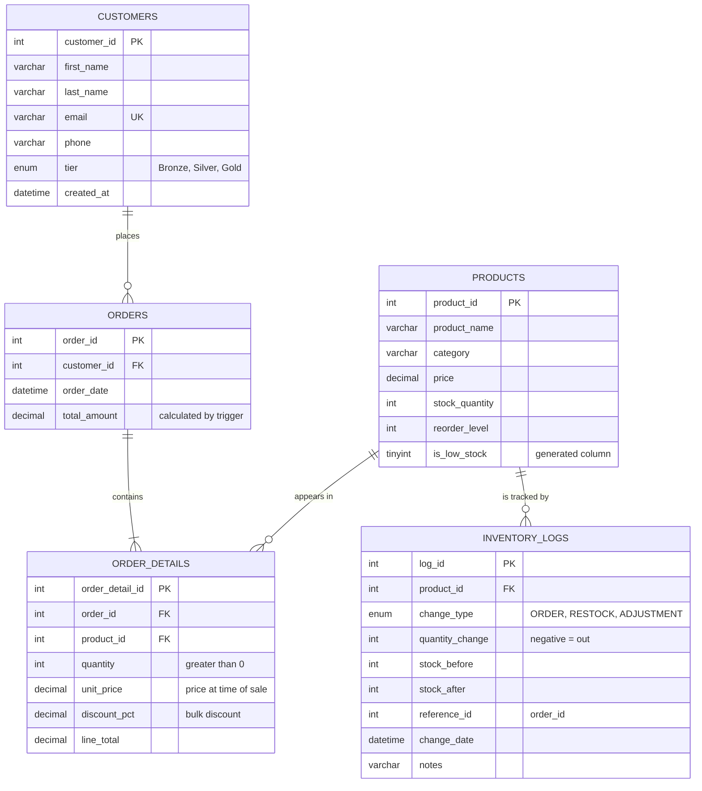

# Entity Relationship Diagram

GitHub renders the diagram below automatically.

## Relationships

| Relationship | Type | Rule on delete |
|---|---|---|
| Customers → Orders | One-to-many | `RESTRICT`: a customer with orders cannot be deleted |
| Orders → Order_Details | One-to-many (at least one) | `CASCADE`: deleting an order removes its lines |
| Products → Order_Details | One-to-many | `RESTRICT`: a product that has been sold cannot be deleted |
| Products → Inventory_Logs | One-to-many | `RESTRICT`: protects the audit trail |

Orders and Products have a **many-to-many** relationship, which is resolved through the Order_Details junction table. A `UNIQUE (order_id, product_id)` constraint ensures each product appears only once per order.
